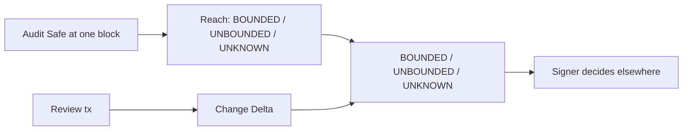

<p align="center">
  
</p>

<h1 align="center">SAVIOURS</h1>

<p align="center"><strong>Safe Treasury Permission Auditor</strong></p>

<p align="center">
  Who can act through a Safe beyond the owners, read from mainnet at one pinned block.<br />
  <strong>Audit</strong> Findings · Coverage · Freshness · Reach → <strong>Review</strong> a change → signer decides.<br />
  Roles v2.1.1 selectors come from chain logs. Condition amounts stay UNKNOWN. Never SAFE.<br />
  <a href="https://www.saviours.xyz">/</a> · <a href="https://www.saviours.xyz/audit">/audit</a> · <a href="https://www.saviours.xyz/review">/review</a> · <a href="https://www.saviours.xyz/docs">/docs</a> · <a href="https://www.saviours.xyz/integrate">/integrate</a> · <a href="https://www.saviours.xyz/vision">/vision</a><br />
  <code>pnpm audit:cli</code> · <code>pnpm reach:cli</code> · <code>pnpm review:cli</code> · <code>@saviours/check</code><br />
  NO_VERDICT ≠ SAFE · never claim SAFE · ENS/x402/Watch = Archive or Prototype.
</p>

> **Honesty banner:** Shipped = Safe and Delay inventory, Roles v2.1.1 selectors from chain logs, condition amounts left UNKNOWN. Never SAFE. Brand stays **Saviour**.

| | |
|---|---|
| **App** | [www.saviours.xyz](https://www.saviours.xyz) · [/docs](https://www.saviours.xyz/docs) · [/integrate](https://www.saviours.xyz/integrate) · [/vision](https://www.saviours.xyz/vision) |
| **Integrate** | [/integrate](https://www.saviours.xyz/integrate) · [`docs/INTEGRATE.md`](docs/INTEGRATE.md) · [`docs/BLAST_RADIUS.md`](docs/BLAST_RADIUS.md) |
| **npm** | [`@saviours/check`](https://www.npmjs.com/package/@saviours/check) |
| **GitHub** | [github.com/devhb1/Saviour](https://github.com/devhb1/Saviour) |
| **Support** | [b4harshit01@gmail.com](mailto:b4harshit01@gmail.com) · [@harshitb01](https://twitter.com/harshitb01) |

**Product (interim):** Safe authority audit — [`/audit`](https://www.saviours.xyz/audit) · [`/review`](https://www.saviours.xyz/review).  
**Roadmap:** [`/vision`](https://www.saviours.xyz/vision) · Vision Lock in repo `ZA ENDGAME FILES/SAVIOUR_BLAST_RADIUS_VISION.md`.



**Locked archive** (investigate-once / ENS): [`/legacy/v1`](https://www.saviours.xyz/legacy/v1) — commit `4e78cad…`. See `apps/web/src/legacy/v1/FROZEN.md`.

---

## Why this exists

Multisig thresholds stop being the control boundary once a module or Zodiac Roles policy exists. Pre-sign tools miss drains when **no owner signs**. Saviour reconstructs standing authority from the Safe, its Delay, and Roles v2.1.1 permission logs, then diffs a proposed change. Condition amounts stay UNKNOWN. Coverage stays honest. Never SAFE.

Legacy ENS / Graph naming loop is **Archive only** — not the product.

---

## Product law (authority audit)

1. Never stamp **SAFE**. Verdicts are Findings · Coverage · Freshness · Reach (`BOUNDED` / `UNBOUNDED` / `UNKNOWN`).
2. NO_VERDICT / UNKNOWN ≠ endorsement.
3. Mainnet reads for control state; block-pin when auditing.
4. Signer decides in Safe UI / HW wallet — Saviour never auto-blocks.
5. Cannot detect compromised keys — only what a key/module can already do.
6. ENS / x402 / MCP / Registry / Watch-as-product are frozen or prototype until after Blast Radius M4.

### Quick start

```bash
pnpm audit:cli --safe 0x…
pnpm review:cli --fixture term
```

Full paths: [`docs/INTEGRATE.md`](docs/INTEGRATE.md).

---

## Architecture

Read-only mainnet auditor. Chain state at one block is the trust root. A shared report is the Safe, that block, and a digest that ignores which RPC host answered.

| Layer | Role |
|---|---|
| `/audit`, `pnpm audit:cli` | Owners, modules, Delay, Findings, Coverage, Freshness, Reach |
| Roles v2.1.1 | Permission events decoded from `eth_getLogs`. An index is only a labeled fallback, and then status stays partial |
| `/review` | Safe transaction hash and privilege diff. The signer decides elsewhere |
| Intent CI | `UNKNOWN` is `INCONCLUSIVE`. `UNBOUNDED` is `FAIL` |

| May decide | Must not |
|---|---|
| Pinned `eth_call` and decoded logs | Invent a token bound from an unread condition tree |
| Coverage gaps | Turn an unread Roles tree into `UNBOUNDED` because a Delay sits nearby |
| `UNKNOWN` | Mean SAFE |

Roles v1, including the 16 Nov module, is identified and not interpreted. Guards and Delay lifecycle stay partial. ENS, Graph, and the agent loop are archive (`/legacy/v1`).

---

## Use it

| Who | Path | Result |
|---|---|---|
| Treasury operator | [/audit](https://www.saviours.xyz/audit) | Paste a mainnet Safe |
| Co-signer | `?safe=&block=&digest=` | Re-audit of that block, match or mismatch |
| Engineer | `pnpm audit:cli --safe 0x…` · `GET /api/audit` · `@saviours/check` | Same engine |

```bash
pnpm install && cp .env.example .env
# ETH_RPC_URL or MAINNET_RPC_URL for pinned reads
pnpm audit:cli --safe 0x…
pnpm dev    # http://localhost:3000/audit
```

A checked-in Roles shape lives at `fixtures/authority/v211-roles-shape.json`. `pnpm --filter @saviours/check test` fails if the replay or SDK flatten drifts from it.

---

Production writes are **fail-closed** unless both `SAVIOURS_ALLOW_WRITES=1` and `NEXT_PUBLIC_SAVIOURS_ALLOW_WRITES=1`.

---

## Prove it without our server

```bash
cast call 0xF479306621F718F7d76875f67506ceD33717751c \
  "text(bytes32,string)(string)" \
  $(cast namehash 0x935bfb495e33f74d2e9735df1da66ace442ede48.saviours.eth) \
  saviours.status \
  --rpc-url $SEPOLIA_RPC_URL
# → TAINTED
```

Or open [`consumers/plain-shield.html`](consumers/plain-shield.html) / run [`consumers/live-agent`](consumers/live-agent).

---

## Repo layout

| Path | Role |
|---|---|
| `apps/web` | Next.js UI + APIs |
| `packages/core` | Graph · signals · investigate · ENS · Shield |
| `packages/check` | Client SDK |
| `packages/mcp` | MCP server |
| `contracts` | SavioursRegistry (Foundry) |
| `consumers/` | live-agent · plain-shield |
| `evals/` · `deployments/` | Locked targets · on-chain records |
| `docs/` | Architecture · diagrams · integrate · recipes |

| Depends on | |
|---|---|
| `apps/web` · `packages/mcp` | → `packages/core` |
| `packages/check` · `consumers/plain-shield` | → ENSv2 Sepolia (no our server) |
| `packages/core` | → The Graph mainnet · ENSv2 · SavioursRegistry |
| `apps/web` | → Bazantic gateway (meter) |

---

## Docs

| Doc | Purpose |
|---|---|
| [ARCHITECTURE.md](docs/ARCHITECTURE.md) | Full trust · control · data · modules · diagrams |
| [DIAGRAMS.md](docs/DIAGRAMS.md) | All Mermaid in one file — paste into Excalidraw |
| [diagrams/](docs/diagrams/) | Individual `.mmd` sources (one file per board) |
| [GRAPH_QUERIES.md](docs/GRAPH_QUERIES.md) | Messari fan-out · Adapter A |
| [BAZANTIC.md](docs/BAZANTIC.md) | Gateway · pricing tiers · e2e |
| [INTEGRATE.md](docs/INTEGRATE.md) | Agents · wallets · MCP · npm |
| [THREAT_MODEL.md](docs/THREAT_MODEL.md) | Trust assumptions |
| [AI-USAGE.md](docs/AI-USAGE.md) | ETHGlobal AI disclosure |
| [recipes/PUBLISH_KIT.md](docs/recipes/PUBLISH_KIT.md) | Published recipes · paste kit |
| [recipes/safe-swap-with-memory.md](docs/recipes/safe-swap-with-memory.md) | Multi-service recipe |
| [recipes/saviours-check-before-sign.md](docs/recipes/saviours-check-before-sign.md) | Core check-before-sign |

---

## Gates (pre-film)

```bash
pnpm typecheck
pnpm check:shield && pnpm check:ens-resolve && pnpm check:ens-story
pnpm check:clean-pin && pnpm check:mcp && pnpm check:incidents
pnpm bazantic:e2e   # optional: local grant for paid settle
```

---

## Identity (Sepolia)

| Item | Value |
|---|---|
| Parent | `saviours.eth` |
| PermissionedResolver | `0xF479306621F718F7d76875f67506ceD33717751c` |
| UserRegistry | `0x3BA6b1c9F0018cac383C17C2ACA5A4dC0F370De5` |
| SavioursRegistry | `0x8f246dd1f7bdd6d169b3cdb77e95d4e84eaff5db` |

Source of truth: `deployments/*.json` — do not invent addresses.

---

## Scope

**What this is**

- Live Graph evidence on ATTACK-1 (`FLASHLOAN_ONE_SHOT` ∧ `ATOMIC_MULTI_PROTOCOL`) with BOT-1 as a WATCH contrast
- ENSv2 hierarchical memory under `*.saviours.eth` with EAC role ceilings
- MEMORY HIT path: **0 Graph · 0 AI · $0**

**What this is not**

- A broad malware / scam detector
- Eight custom Graph subgraphs — it is **1 Messari template × 8 pinned deployments**
- A decentralized dispute court — EAC is permissioned operators
- Mainnet ENS enforcement of Sepolia memory (stated ceiling)
