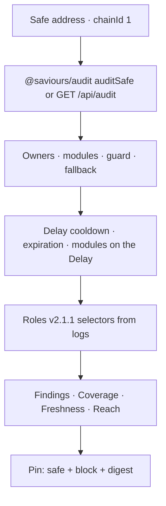
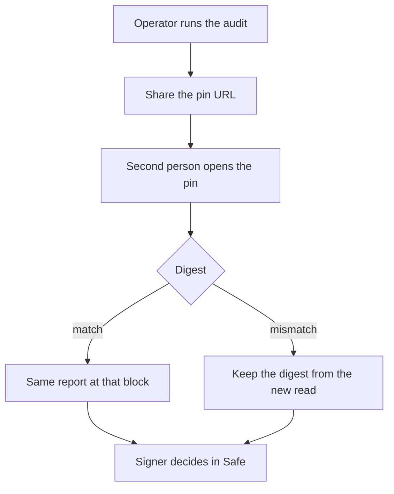
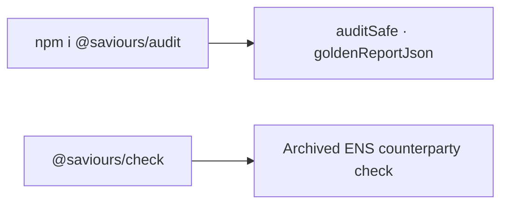

# Integrate Saviour

Safe Treasury Permission Auditor. A read of one mainnet Safe at one block: who can act beyond the owners. Findings, Coverage, Freshness, Reach. The signer still approves in Safe. This product never stamps SAFE.

The pages a person opens are [/integrate](https://www.saviours.xyz/integrate) and [/docs](https://www.saviours.xyz/docs). This file is the same guide for the repo.

## What you are wiring in

| You have | You call | You show |
|---|---|---|
| A signer, a chat, no install | [/audit](https://www.saviours.xyz/audit) | The pin link. The other signer checks **digest match**. |
| A treasury before a signer call | Same page, then the pilot receipt | Both names, the block, the digest. |
| Your own backend or bot | `GET /api/audit` or `auditSafe` | Coverage, findings, and each Reach verdict beside Sign. |

Mainnet only (`chainId` 1). Other chain ids are rejected.

Roles v2.1.1 selectors come from chain logs. Condition amounts stay `UNKNOWN`. Roles v1 is identified and not interpreted. A conditioned or fallback read stays partial. Do not turn `UNKNOWN` into a number, and do not hide an incomplete Coverage.

## 1. A person, no code

1. Open `/audit` and paste the Safe (`0x` and 40 hex characters).
2. Run the audit. Read Findings, then Coverage (`complete: false` is a result), then Reach.
3. Copy **note for the other signer**. It contains the pin URL:

   `/audit?safe=0x…&block=26435999&digest=<64 hex>`

4. The other signer opens that URL. The page re-audits that block. **digest match** means the same report. **digest mismatch** means the link and the new read disagree; keep the digest from the URL.
5. Optional: download a pilot receipt. It counts as adoption only when the operator is outside the Saviour team and a witness saw digest match.

**In plain words** restates the report. A question is answered from that report. It does not change the verdict. It will not stamp SAFE, invent a token amount, or say a past incident would have been prevented.

The Term Safe `0x46DA347d1Db6EdCA62BF6Cd5892Dc284fC938613` is a public example. On 17 Nov 2026 at block `26435999` the owner set was `BOUNDED` (the owner is the dead address) and the roles principal was `UNKNOWN`. That run is a team proof. It is not a customer.

## 2. HTTP API

Host the app, or call a deployment that has `ETH_RPC_URL` or `MAINNET_RPC_URL` set. With neither, the server uses a public mainnet endpoint. An audit can take several seconds. `maxDuration` on the route is 60s. The in-memory limit is 20 audits per IP per minute; `429` means wait and read `Retry-After`.

```http
GET /api/audit?safe=0x46DA347d1Db6EdCA62BF6Cd5892Dc284fC938613&chainId=1
GET /api/audit?safe=0x…&chainId=1&block=26435999
GET /api/audit?safe=0x…&chainId=1&member=0x…
```

| Query | Required | Meaning |
|---|---|---|
| `safe` | yes | Mainnet address, `0x` + 40 hex. |
| `chainId` | no | Defaults to `1`. Any other value fails. |
| `block` | no | Decimal block. Omit it to read the chain head. Set it to re-check a pin. |
| `member` | no | Repeatable. Extra addresses to probe. Invalid addresses are dropped. This does not raise severity. |
| `suspectFreeRecipient` | never | `400`. Fixture-only. The public API does not accept injected findings. |

Response body:

```json
{
  "ok": true,
  "status": "PARTIAL",
  "report": {
    "safeAddress": "0x…",
    "status": "PARTIAL",
    "findings": [{ "severity": "CRITICAL", "rule": "DELAY_BYPASS_PATH", "title": "…", "detail": "…" }],
    "coverage": { "complete": false, "components": [], "gaps": [] },
    "freshness": { "chainId": 1, "blockNumber": "26435999", "blockHash": "0x…", "consistency": "hash-verified-at-end" },
    "reach": { "principals": [{ "principalId": "roles-module:0x…", "verdict": "UNKNOWN", "reasons": [] }] },
    "errors": []
  }
}
```

| `status` | `ok` | HTTP | Meaning |
|---|---|---|---|
| `COMPLETE` | true | 200 | All in-scope checks finished without gaps |
| `PARTIAL` | true | 200 | Usable evidence; Coverage gaps remain |
| `INCONCLUSIVE` | false | 422 | Snapshot or essential evidence failed |
| `INVALID_INPUT` | false | 400 | Bad address, chain, or block |

Read it in this order:

1. `ok` and `status`. Do not treat HTTP 200 alone as success — `INCONCLUSIVE` is a failed audit.
2. `errors`. If non-empty, show them.
3. `coverage.complete`. `false` means the Safe was not fully assessed.
4. `findings`. Empty is not an endorsement.
5. `reach.principals[].verdict`. Each Roles module is its own `roles-module:0x…` principal. `UNBOUNDED` is a fail for a keeper-style check. `UNKNOWN` is inconclusive. `BOUNDED` on the owner set means those owners cannot sign; it does not mean the Safe is safe.
6. `freshness.blockNumber`, `blockHash`, and `consistency`. Put them on anything you store.

Share this URL, not a screenshot:

```text
/audit?safe=<safe>&block=<freshness.blockNumber>&digest=<64 hex sha256>
```

The digest is on the golden report (`reportDigest`), from `POST /api/report` with `{ "report": <the audit report> }`, or from `goldenReportJson` in the SDK. The digest ignores which RPC host answered. It covers the pinned block, the findings, the coverage, and the reach. `POST /api/report` may also write a local file; a host without a disk still returns the golden JSON. The durable share is the pin URL above, because opening it runs the audit again.

Other routes:

| Route | Use |
|---|---|
| `POST /api/audit/explain` `{ "report", "question"? }` | Plain sentences, or an answer to one question. `source` is `report` or `model`. |
| `POST /api/audit/receipt` `{ "report", "operator", "witness"?, "pinUrl", "digest" }` | Markdown receipt. Names are not verified. |
| `GET /api/review/controls?safe=0x…&delay=0x…` | Live Delay and Safe controls for a privilege diff. |

`400` is a bad address or a bad block. `429` is the rate limit. `500` is a read failure; the body `error` has the message with RPC URLs stripped.

A backend that shows Sign should do this:

```ts
const res = await fetch(
  `${SAVIOUR_ORIGIN}/api/audit?safe=${safe}&chainId=1`,
);
const { ok, report, error } = await res.json();
if (!res.ok || !ok) throw new Error(error ?? res.statusText);

const unbounded = (report.reach?.principals ?? []).filter(
  (p: { verdict: string }) => p.verdict === "UNBOUNDED",
);
// Show report.coverage, report.findings, and unbounded.
// Do not enable a "safe to sign" state from this response.
```

## Flows



Roles v1 is named on the inventory step and is not interpreted. Condition amounts stay unknown.



A match means this engine reproduced the report. It is not a signature of who ran it. Saviour does not block the signature.



## 3. SDK

Published: [@saviours/audit](https://www.npmjs.com/package/@saviours/audit) `0.1.0`. Node 20 or newer. ESM only.

```bash
npm i @saviours/audit
```

`@saviours/audit` is this auditor. `@saviours/check` on npm is an older ENS counterparty check and does not install this API.

Set `ETH_RPC_URL` or `MAINNET_RPC_URL` in the process that calls `auditSafe`. The package reads mainnet. It does not take a chain other than 1.

```ts
import { auditSafe, goldenReportJson, type Hex } from "@saviours/audit";

const audit = await auditSafe({
  safeAddress: "0x46DA347d1Db6EdCA62BF6Cd5892Dc284fC938613" as Hex,
  chainId: 1,
  // blockNumber: 26435999n, // only when re-checking a pin
});

const golden = JSON.parse(goldenReportJson(audit));
const pin =
  `/audit?safe=${audit.safeAddress}` +
  `&block=${audit.freshness?.blockNumber}` +
  `&digest=${golden.reportDigest}`;
```

`probeMembers` is optional and is not proof of membership by itself. `fixtureAssumptions` is for tests. Do not set it in a product path.

Transaction review (`assessAndExplain`) is not in this package. Run it from a checkout with `pnpm review:cli`. Pass the Safe UI `safeTxHash` as `expectedSafeTxHash`. The checker must not mark a hash as a match against itself.

## 4. CLI

From a checkout of this repo, with `ETH_RPC_URL` set:

```bash
pnpm audit:cli --safe 0xYourSafe
pnpm audit:cli --safe 0xYourSafe --json-full
```

`--fixture reference` and `pnpm review:cli --fixture term` rerun checked-in examples. They are not a live treasury. `pnpm intent:cli` checks the shape of an intent file. The auditor does not yet produce token amounts, so a CI job must not fail a pull request for exceeding a quantity this report never computed. `UNKNOWN` is inconclusive. `UNBOUNDED` on a role member is a fail.

## 5. What not to integrate yet

| Surface | Status |
|---|---|
| Safe App iframe, Safe Transaction Service import | Written as a later step in `docs/STS_SAFE_APP.md`. Not built. Paste the Safe, or call the API. |
| Roles v1 reader | Identified only. The 16 Nov 2026 module is in this bucket. |
| Condition trees as token amounts | Counted, not evaluated. |
| ENS, Graph, agent shield, x402 | Archive at `/legacy/v1`. Not this product. |

Zodiac App is where an operator edits Roles. Safe UI is where they sign. Saviour is the independent read of what those modules can already do.
